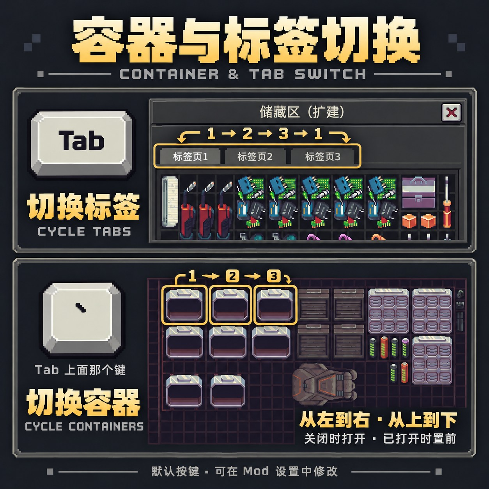

# 容器与标签切换 / Container & Tab Switch (原名Tab 切换储存标签 / Storage Tab Cycle)



用快捷键循环切换储存区标签和容器。

- **Tab**：切换当前扩容储存区的下一标签页，最后一页回到第一页。
- **反引号键（Tab 上面那个“`”键）**：按从左到右、从上到下的顺序，循环切换柜台下方主物品栏里的容器。关闭的容器会打开，已打开的容器会切到最前面。跳过未解锁的容器，不进入箱包内部的嵌套容器。

在游戏 **Mod 管理 → 选择本 Mod → 设置** 中分别修改“切换标签”和“切换容器”的按键，点击“应用”后生效并保存。`BackQuote` 表示反引号键，`None` 表示禁用。如果两项使用同一个按键，优先切换容器。

容器的顺序跟随主物品栏里的摆放位置，以左上角所在格子逐行排序。手动点击某个符合条件的容器后，从它继续循环。Tab 操作当前位于最前面的扩容储存区窗口。

无需前置 Mod。在游戏 Mods 菜单中启用后，重启游戏即可使用。

Cycle storage tabs and containers with configurable hotkeys.

- **Tab**: switch to the next tab in the current expanded storage bay, wrapping from the last tab to the first.
- **The backquote key (`), just above Tab**: cycle containers in the main inventory beneath the counter, from left to right and top to bottom. Closed containers open; open containers come to the front. Locked containers and containers nested inside bags or boxes are skipped.

Select this mod in the game's **Mod manager → Settings** to change either shortcut. Click **Apply** to save and use the new bindings. `BackQuote` is the backquote key; `None` disables a shortcut. If both actions share a key, the container action takes priority.

Container order follows each item's top-left grid position and updates when items are moved. Manually focus an eligible container to continue cycling from it. Tab affects the foreground expanded storage window.

No dependencies. Enable the mod in the game's Mods menu and restart the game.

**[Steam 创意工坊订阅 / Subscribe](https://steamcommunity.com/sharedfiles/filedetails/?id=3831400376)** · **[安装包 / Releases](https://github.com/w7lau/probably-stolen-tab-switch/releases)**

## 安装

从 [Releases](https://github.com/w7lau/probably-stolen-tab-switch/releases) 下载 `StorageTabCycle-1.1.0.zip`，解压到游戏根目录的 `Mods` 文件夹。

```text
Probably Stolen/
  Mods/
    StorageTabCycle/
      manifest.xml
      StorageTabCycle.dll
```

在游戏 Mods 菜单启用 **容器与标签切换 / Container & Tab Switch** 并重启游戏。卸载时停用并重启，再删除 Mod 文件夹即可。

Extract the release ZIP into the game's `Mods` directory, enable the mod in the Mods menu, then restart.

## 构建

需要合法安装的正式版游戏和 .NET SDK；源码及发布包均不分发游戏程序集或 Harmony。

```powershell
.\build.ps1 -GameDir 'D:\SteamLibrary\steamapps\common\Probably Stolen'
```

生成 `package/StorageTabCycle` 和对应版本的 `dist/StorageTabCycle-1.1.0.zip`，不会自动安装或启用。项目以 `netstandard2.1` 为目标。

离线调用游戏自带扫描器（需要 .NET 9 SDK）：

```powershell
dotnet run --project tools/Scan -p:GameDir='D:\SteamLibrary\steamapps\common\Probably Stolen' -- package/StorageTabCycle 'D:\SteamLibrary\steamapps\common\Probably Stolen\Probably Stolen_Data\Managed'
```

## 兼容性

- 编译依据：Steam build **26337366**。游戏日志的 Mod 兼容版本字符串为 **0.46D**，manifest 使用该值，它与商店公告版本号不同。
- 快捷键不会屏蔽游戏或其他 Mod 的同名按键操作，可在本 Mod 设置中更换按键。输入文字、打开 Mod 设置、游戏设置或暂停菜单时不触发。

## 创意工坊

创意工坊的内容文件夹使用构建后的 `package/StorageTabCycle`，不要上传源码项目、工具目录或 ZIP。
App ID 为 **4348910**。可按[官方指南](https://github.com/dragonpan2/probably-stolen-modding/blob/main/ModdingGuide.md#steam-workshop)使用 SteamCMD 发布。

## 许可

本项目原创代码使用 [MIT License](LICENSE)。游戏及其依赖的知识产权属于各自权利人。
